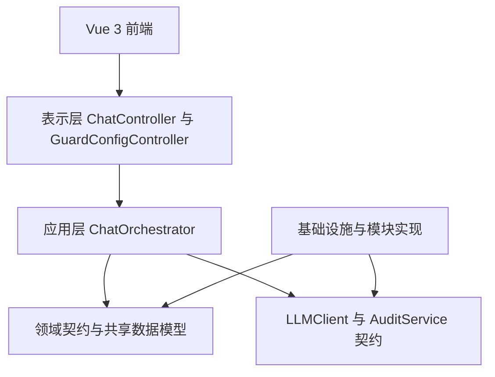
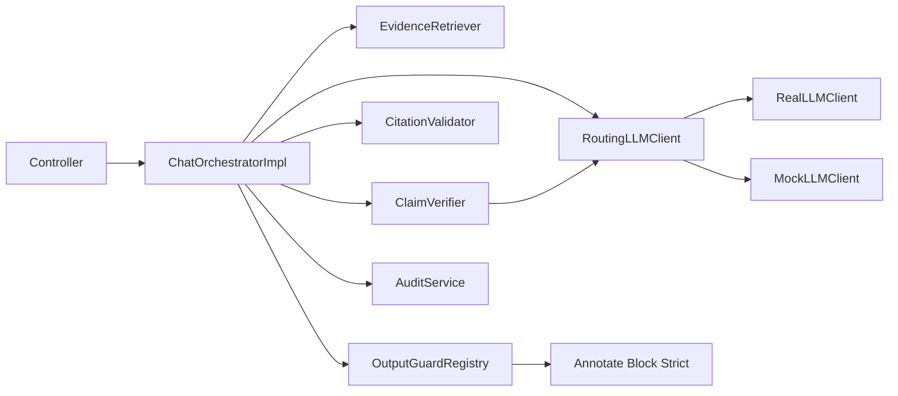
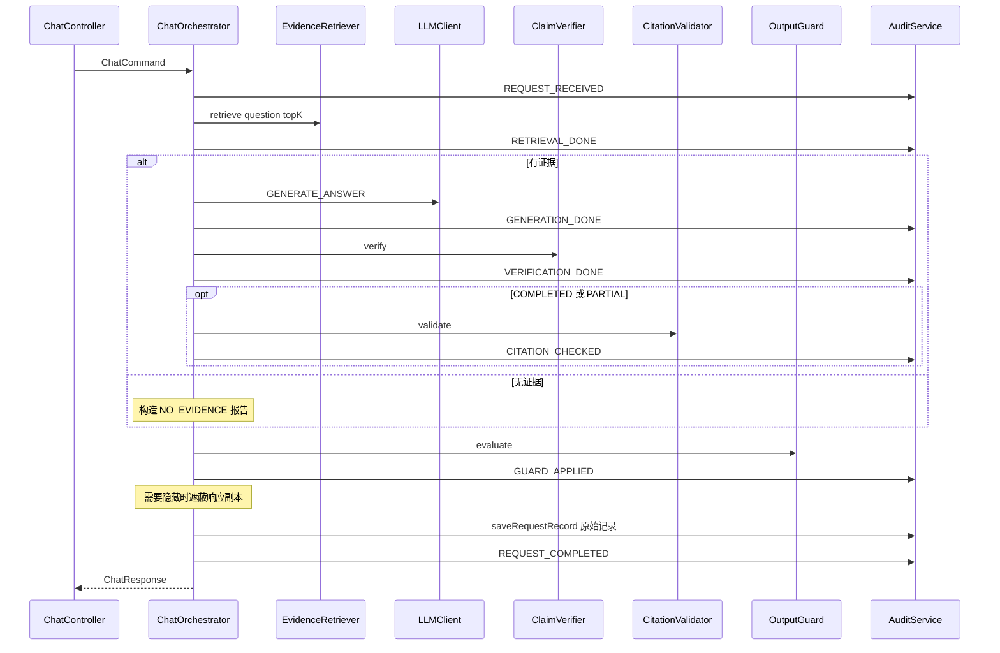
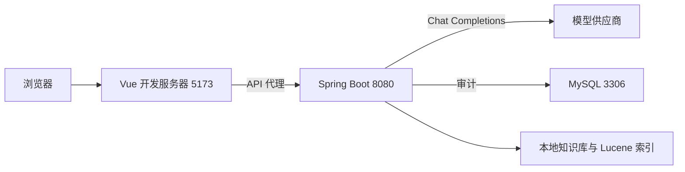

# AI Guardian 架构设计与报告素材

## 第 4 章 架构设计

系统采用 Java 17 和 Spring Boot 3.3 的模块化单体。一次问答由同一个后端进程按顺序编排，模块边界由 Java 接口定义。表示层处理 HTTP 输入与输出，应用层管理问答生命周期，核心领域层定义证据、核验和输出防护的契约，基础设施层提供模型、检索与审计适配器。

## 第 5 章 架构风格与模式

- 策略模式用于输出防护。编排器按策略名从 `OutputGuardRegistry` 取得 Bean，策略共享同一份核验报告。
- 模型接入采用适配器。 `RealLLMClient` 将内部请求映射为 Chat Completions 并统一异常类型，路由根据运行模式选择实现。
- 应用层注入接口，通过 Spring 装配各模块的实现。 `stub` profile 提供可运行的固定数据替身，支持在其他模块开发期间联调。
- 审计属于生命周期的一部分。每次请求有单独的 requestId，sessionId 仅用于消息归组。

## 第 6 章 组件与接口

接口以[附录第 4 章](../interface-contract.md#4-核心接口java)为准。检索接口增加 `topK` 和 `findById`，支持返回条数控制和原文查询。核验接口改用 `VerificationInput`，使请求 ID、模式和场景 ID 随调用传递。输出策略接口增加 `GuardPolicy`，支持每次请求覆盖策略与阈值。引用校验接口保持接收报告与证据。

## 第 7 章 数据流

检索异常保存失败记录并写入 `REQUEST_FAILED`。生成异常额外写入 `GENERATION_FAILED`。核验失败继续交由输出策略。审计写入失败记录错误日志，问答响应仍按原流程返回。

## 第 9.3 节 可修改性

见[实验记录](../modifiability.md)。策略实验通过 Spring 发现新 Bean，阈值实验固定策略与 Stub 输入，通过一个配置值改变输出。

## 第 9.6 节 架构权衡

- 模块化单体降低五人小组的部署、日志关联和服务间通信成本，各模块共享同一进程的容量和故障域。
- Lucene BM25 适合小规模中文制度库，部署依赖少，文档词项和召回结果可解释。语义近似问题仍依赖中文分词、词汇覆盖及同义词处理。
- 批量核验将多条结论合并到一次调用，逐条核验更容易隔离某条结论的失败，但会增加模型调用次数。具体延迟差异以全组实测为准。
- `block` 的 Fail-Closed 行为会在核验不可用时降低回答可用性。它缩小了未经核验正文被误当作可用结论的机会。

## 第 11 章 局限性

核验结论的覆盖范围取决于本次检索和模型提取。证据原文存在只能证明引用可追溯，引用是否支持对应结论仍依赖模型判断。真实模型可能在小规模知识库上很少产生幻觉，固定测试场景用于重复演示标注与拦截。真实模型与知识库的联调结果、全组回归和性能数据待对应模块与环境就绪后补齐。

## 答辩讲稿要点

第 4–5 页讲四层职责和一次问答的调用顺序。第 8 页用同一份核验报告演示标注与拦截，展示回答正文如何遮蔽。第 12 页展示 `StrictOutputGuard` 的单类提交及阈值实验的单行配置差异。
